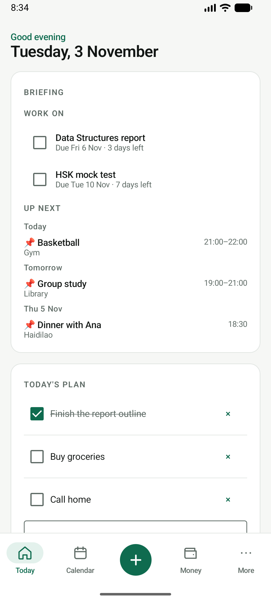
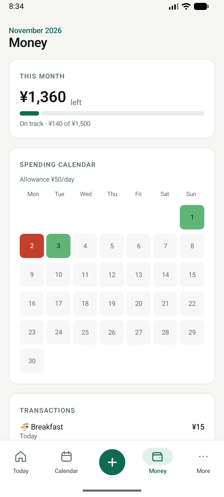
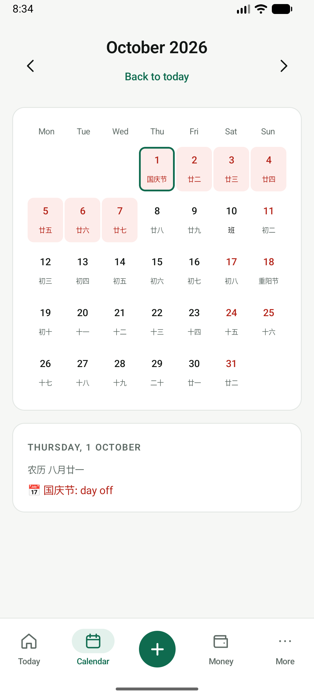
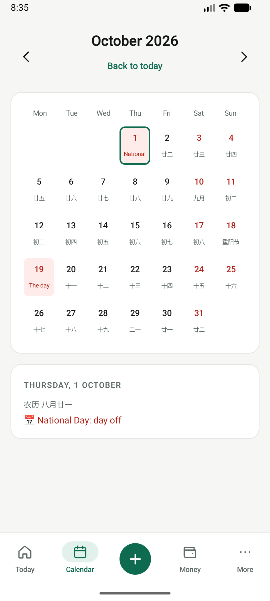

# Pulse Lite

Your day, money and plans, on your phone. An offline Android app for students and workers in **Mainland China** or **Hong Kong**.

No account, no server, no internet: install the APK and it just works. Everything stays on the phone.

<p align="center">
  
  
  
  
</p>

<p align="center"><sub>Today · Money · Calendar (Mainland China) · Calendar (Hong Kong). Screenshots use made-up demo data.</sub></p>

## Features

- **Today:** holidays and 调休 workdays this week, deadlines to work on, what's up next, a day plan you tick off, and what's left to spend.
- **Money:** one monthly budget in ¥ or HK$, what's safe to spend today, on track / above pace / over, a spending calendar from green to red, and your transactions.
- **Calendar:** lunar dates (农历) and festivals, official days off in red, 调休 make-up workdays marked 班, your events and deadlines.
- **Quick add:** an expense in two taps (number pad, then a category), or an event or deadline.
- **Setup in a minute:** pick Mainland China or Hong Kong and a monthly budget.

## How it works

- **Kotlin + Jetpack Compose + Material 3**, one activity, no extra libraries.
- **Data:** one private JSON file in the app's own storage. The app has no internet permission, so nothing leaves the phone. Reset (in More) deletes everything.
- **Money is exact:** amounts are whole cents in a `Long`, never a decimal.
- **Lunar dates** come from Android's built-in Chinese calendar (`android.icu`).
- **Holidays** are bundled for 2026: Mainland China (State Council schedule, with 调休) and Hong Kong (the government's 1823 list), in `app/src/main/assets/holidays/`.

## Project layout

```
app/src/main/java/com/dapid/pulse/
  data/      Budget, Rules, Lunar, Format, Store (the logic, no UI)
  ui/        PulseRoot, PulseApp (tabs and the + sheet), theme, components
  ui/screens Setup, Today, Money, Calendar, add forms, More
app/src/test/  JUnit tests for the budget maths, rules, lunar names and formatting
```

## Build and run

Needs Android Studio (or JDK 17+ and the Android SDK). Android 8.0 (API 26) or newer.

```bash
./gradlew testDebugUnitTest   # 18 unit tests
./gradlew assembleDebug       # APK in app/build/outputs/apk/debug/
```

Or open the folder in Android Studio and press Run.

## Not in Lite

Holidays after 2026 (added once they're published), backup and sync between phones, foreign currencies, and iPhone.
